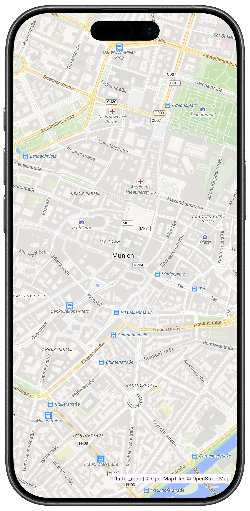
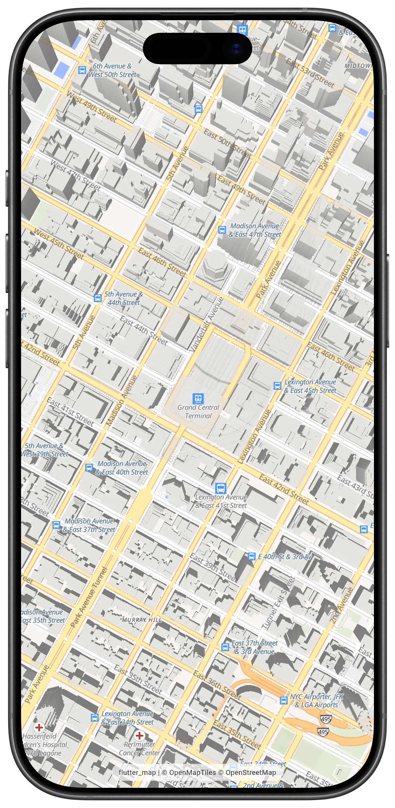
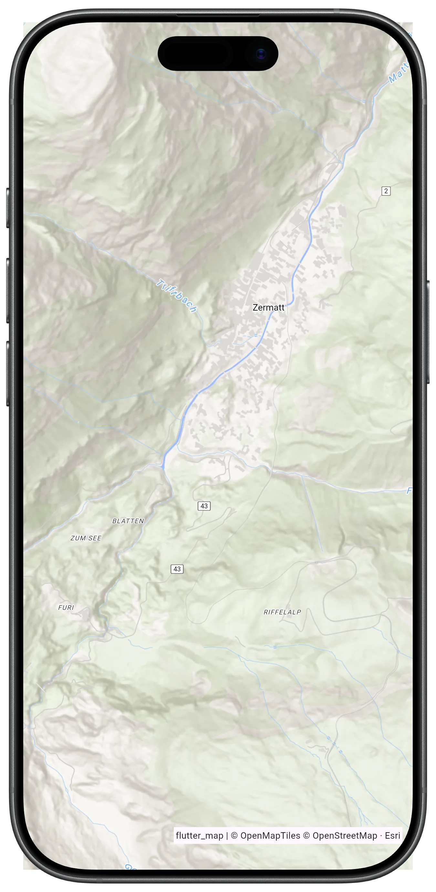
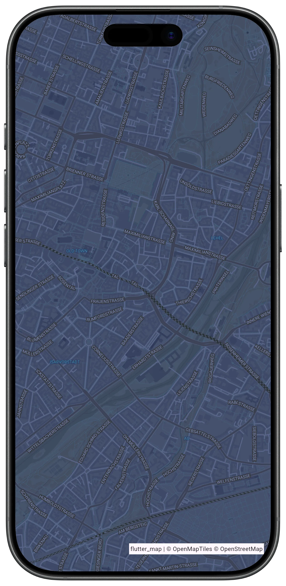
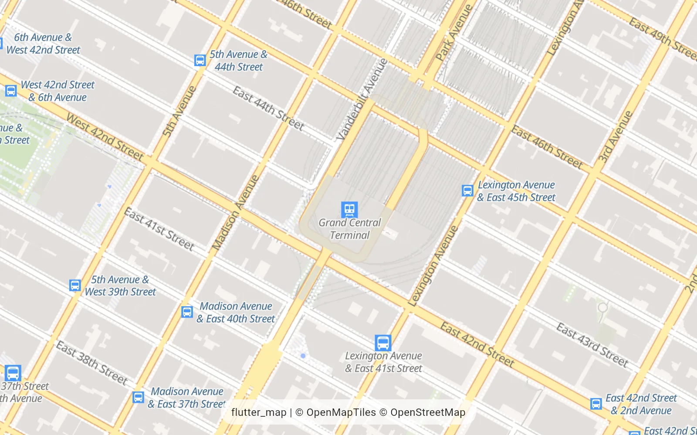
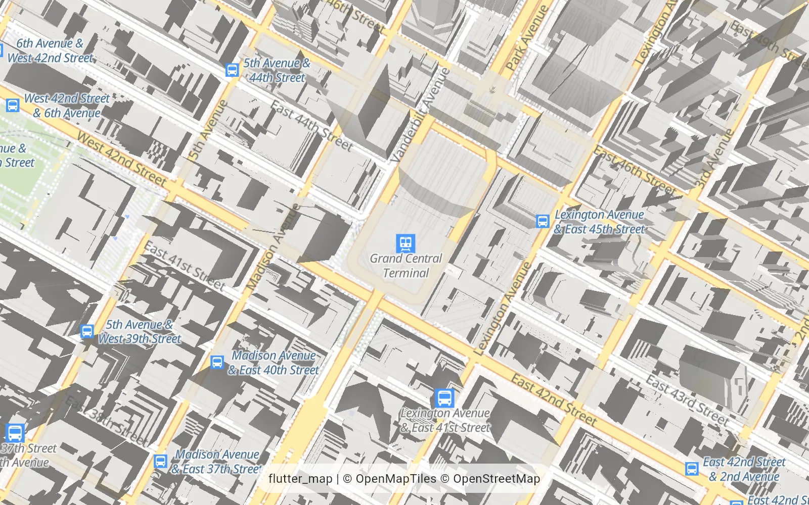
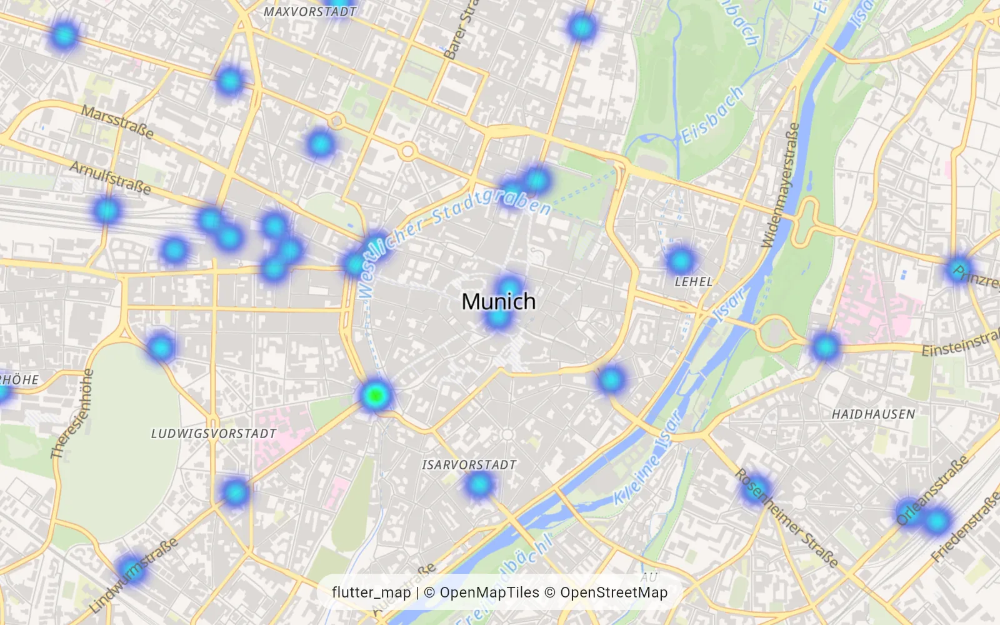
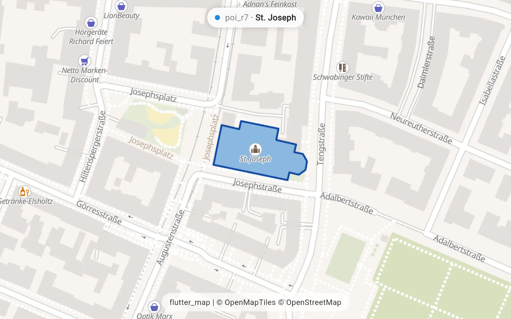
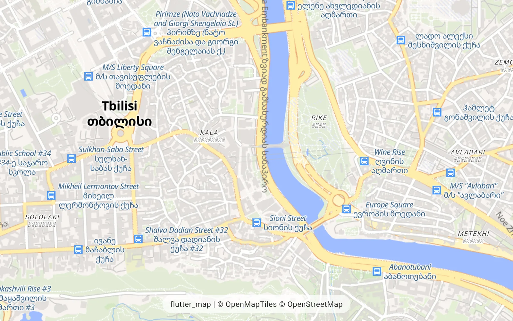
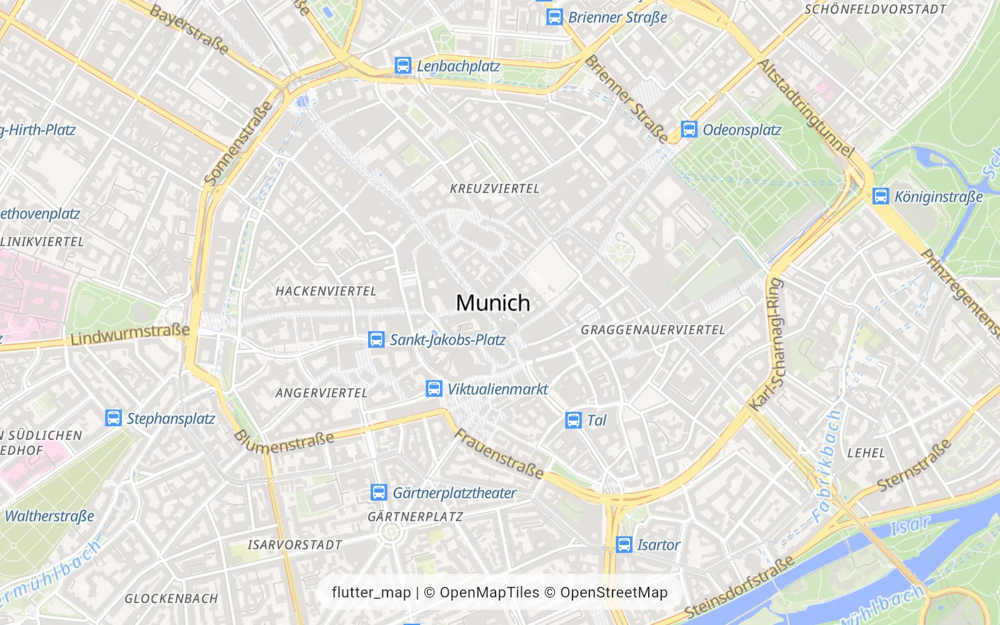

# 🗺️ flutter_map_vector_tiles

[](https://pub.dev/packages/flutter_map_vector_tiles)
[](https://github.com/JonasGrunau/flutter-map-vector-tiles/actions/workflows/ci.yml)
[](LICENSE)
[](https://pub.dev/packages/flutter_map)

**Vector tiles for [`flutter_map`](https://pub.dev/packages/flutter_map).**
Renders MapLibre / Mapbox GL styles (MapTiler, OpenFreeMap, Stadia,
Protomaps, …) straight from vector tiles, as a plain flutter_map layer.
flutter_map keeps the camera, the gestures and your other layers; this
package only draws the map.

<p align="center">
  
  
  
  
</p>
<p align="center">
  <em>Any MapLibre style · 3D buildings · hillshade · dark styles</em>
</p>

[**Live demo**](https://jonasgrunau.github.io/flutter-map-vector-tiles/) ·
[Documentation](#-documentation) ·
[pub.dev](https://pub.dev/packages/flutter_map_vector_tiles)

## ✨ Features

- 📦 **One package.** MVT decoding, style engine and renderer in one
  dependency, with no native code.
- 🚀 **Smooth.** Each tile's geometry is rasterized once into a GPU image
  (`Picture.toImageSync`), so pan, zoom and rotate only move textures.
  Tiles decode on a pool of worker isolates, viewport-centre first.
- 🔍 **Crisp labels.** Drawn in screen space, in the style's own fonts:
  upright when the map rotates, sharp at any zoom, never cut at a tile
  seam.
- 🌫️ **No white flashes.** New tiles fade in over retained ancestor
  imagery: zoom-ins render from the parent tiles already decoded,
  zoom-outs from the children.
- 🏙️ **3D buildings, hillshade, heatmaps.** Along with fills, lines,
  patterns, symbols and raster layers, drawn as MapLibre draws them.
- ✈️ **Works offline.** The style and the tiles you visited are cached on
  disk, in a size-capped cache with no index files to corrupt. PMTiles
  and MBTiles archives cover whole regions.
- 👆 **Queries and feature state.** Ask what is drawn at a tap and
  highlight features from the style.
- 🛡️ **Hard to break.** Unknown layer types and exotic expressions degrade
  per layer with a warning, and a cancelled tile load is a state, never
  an exception in your crash reporting.
- 🌐 **Six platforms.** Android, iOS, macOS, Linux, Windows and web.

Built for flutter_map ≥ 8.2 and modern Flutter (Impeller). A clean,
self-contained rewrite of the ideas behind
[`vector_map_tiles`](https://pub.dev/packages/vector_map_tiles);
[how the two compare](#-compared-with-vector_map_tiles) is below.

## 🚀 Quick start

### 1. Install

```yaml
dependencies:
  flutter_map: ^8.2.0
  flutter_map_vector_tiles: ^2.11.1
```

### 2. Load a style & drop in the layer

```dart
import 'package:flutter_map/flutter_map.dart';
import 'package:flutter_map_vector_tiles/flutter_map_vector_tiles.dart' as vt;
import 'package:latlong2/latlong.dart';

// Load the style once. MapTiler shown, any MapLibre style URL works.
final style = await vt.StyleReader(
  uri: 'https://api.maptiler.com/maps/streets-v2/style.json?key={key}',
  apiKey: myMapTilerKey,
).read();

// Use it like any other flutter_map layer:
FlutterMap(
  options: MapOptions(
    initialCenter: style.center ?? const LatLng(48.137, 11.575),
    initialZoom: style.zoom ?? 12,
    maxZoom: 21,
  ),
  children: [
    vt.VectorTileLayer(
      theme: style.theme,
      tileProviders: style.providers,
      rasterSources: style.rasterSources,
      sprites: style.sprites,
      glyphs: style.glyphs, // labels in the style's own fonts
    ),
    // Show what the style's sources ask for; most providers require it.
    SimpleAttributionWidget(
      source: Text(style.attributions.map((a) => a.text).join(' · ')),
    ),
    // ...your markers, polylines, etc.
  ],
);
```

`style.attributions` comes pre-parsed: each entry pairs the flattened
`text` shown above with `spans`, whose runs keep the `url` of the `<a>`
tag they came from. Build from those when your provider's terms call for
*tappable* links.

### 3. Clean up

```dart
@override
void dispose() {
  style.dispose(); // releases HTTP clients, sprite images & glyphs
  super.dispose();
}
```

▶️ A runnable app lives in [`example/`](example):

```bash
cd example
flutter run --dart-define=MAPTILER_KEY=yourKey
```

## 🖼️ What it draws

<table>
  <tr>
    <td width="50%" align="center" valign="top">
      <br>
      Buildings as styles draw them by default …
    </td>
    <td width="50%" align="center" valign="top">
      <br>
      … and as <a href="doc/STYLE_SUPPORT.md#3d-buildings">3D buildings</a>, with <code>ExtrusionMode.perspective</code>
    </td>
  </tr>
  <tr>
    <td width="50%" align="center" valign="top">
      <br>
      <a href="doc/STYLE_SUPPORT.md#heatmaps">Heatmap</a> layers
    </td>
    <td width="50%" align="center" valign="top">
      <br>
      A tap, <a href="doc/QUERYING.md">queried</a>: the top hit in the pill, the building under it highlighted through feature state
    </td>
  </tr>
  <tr>
    <td width="50%" align="center" valign="top">
      <br>
      Labels in the style's own <a href="doc/LABELS.md#fonts">fonts</a>
    </td>
    <td width="50%" align="center" valign="top">
      <br>
      Labels stay upright when the map rotates (<a href="doc/LABELS.md#choosing-a-label-mode">label modes</a>)
    </td>
  </tr>
</table>

Map data © [OpenMapTiles](https://openmaptiles.org) ©
[OpenStreetMap](https://www.openstreetmap.org/copyright) contributors,
styles by [OpenFreeMap](https://openfreemap.org).

## ⚙️ Options

Everything has a default. The ones you are most likely to touch:

| Option | Default | What it does |
|---|---|---|
| `glyphs` | none | `style.glyphs`: labels in the style's own fonts instead of the system font |
| `labelMode` | `LabelMode.screen` | `LabelMode.tile` bakes labels into the tiles: no per-frame label cost, but they turn with the map |
| `extrusionMode` | `ExtrusionMode.flat` | `ExtrusionMode.perspective` draws `fill-extrusion` layers as 3D buildings |
| `tileOffset` | `TileOffset.maplibre` | renders 512 px styles as their authors designed them; `TileOffset.none` shows one zoom level more detail |
| `diskCacheMaximumSizeInBytes` | 50 MB | disk cache for tiles; `0` turns it off |
| `diskCacheTtl` | 14 days | how long a cached tile skips the network |
| `showLabels` | `true` | `false` turns off all text and icons |
| `controller` | none | a `VectorTileLayerController`, for queries and feature state |
| `logger` | none | `const vt.Logger.console()` prints style warnings |

`StyleReader(language: 'de')` shows labels in one language where the
tiles carry it. All options, cache budgets and the frame budget are in
[Configuration](doc/CONFIGURATION.md).

## 🌍 Tile sources

Any MapLibre `style.json` works. Verified with
[MapTiler](https://maptiler.com), [OpenFreeMap](https://openfreemap.org)
(free, no key), [Stadia Maps](https://stadiamaps.com), ArcGIS / Esri,
[Protomaps](https://protomaps.com) and self-hosted servers (TileServer
GL, Martin, …).

- **PMTiles**: `pmtiles://` source URLs in a style work out of the box.
- **MBTiles**: through the companion package
  [`flutter_map_vector_tiles_mbtiles`](https://pub.dev/packages/flutter_map_vector_tiles_mbtiles).
- **Your own**: implement `VectorTileProvider`, four methods.
- **Web**: works, without a disk cache; the style and tile hosts must
  send CORS headers.

URL shapes per provider, offline behaviour and the browser differences
are in [Tile sources, offline and web](doc/TILE_SOURCES.md).

## 🆚 Compared with `vector_map_tiles`

Against [`vector_map_tiles`](https://pub.dev/packages/vector_map_tiles)
`9.0.0-beta.13`, the newest release that runs flutter_map 8 on stable
Flutter (the
[`10.0.0` betas](https://pub.dev/packages/vector_map_tiles/versions) need
Flutter's main channel for `flutter_gpu`, per
[their README](https://github.com/greensopinion/flutter-vector-map-tiles#version-1000-beta)):

| | vector_map_tiles 9.0.0-beta.13 | this package |
|---|---|---|
| Packages | 3 ([`vector_map_tiles`](https://pub.dev/packages/vector_map_tiles), [`vector_tile_renderer`](https://pub.dev/packages/vector_tile_renderer), [`executor_lib`](https://pub.dev/packages/executor_lib)), plus `idb_shim` for its web cache | 1 |
| Labels | raster mode (default): baked into each tile image, collision within the tile; vector mode: redrawn with the tiles every frame | a screen-space pass with one global collision pass and upright text (default), or baked into the tile images with `LabelMode.tile` |
| Style zoom | evaluated at the flutter_map zoom, one level deeper than MapLibre, so label layers open a level early | `TileOffset.maplibre` by default, as MapLibre renders the style |
| Tile images | 512 px, `Picture.toImage`, then PNG-encoded into its disk cache before the tile is shown; a revisit decodes the PNG | 256 px × device pixel ratio, `Picture.toImageSync`, kept as GPU textures in an LRU |

Measured with [`compare/`](compare) on a Nothing Phone (1) (Android,
60 Hz), an iPhone 15 Pro Max (iOS, 120 Hz), a MacBook Pro with an M4 Pro
(macOS, 120 Hz) and Chrome on that Mac: same style, same recorded tiles,
a fresh process per run, three runs each (four on the iPhone). "Frames"
is the share of display refreshes that got a frame while the camera
zoomed, panned, rotated or flung. Each cell reads this package /
`vector_map_tiles`.

| this package / vector_map_tiles | Android | iOS | macOS | Chrome |
|---|---:|---:|---:|---:|
| Labels baked into the tiles (`LabelMode.tile` / raster mode): frames | 94–98% / 75–98% | 99.6–100% / 97–100% | 98–100% / 99–100% | 95.5–99.9% / 41–100% |
| … worst frame gap | 50–117 / 67–251 ms | 8–18 / 8–38 ms | 8–25 / 8–42 ms | 13–117 / 11–158 ms |
| Labels drawn every frame (default / vector mode): frames | 91–96% / 20–40% | 99.5–100% / 67–99.8% | 97–100% / 64–99.9% | 95–100% / 3–76% |
| … worst frame gap | 50–100 / 100–1304 ms | 8–17 / 17–133 ms | 8–33 / 14–183 ms | 10–42 / 100–833 ms |
| First complete map (baked / raster) | 0.68 / 2.75 s | 0.35 / 1.74 s | 0.28 / 0.93 s | 1.12 / 2.49 s |
| Downloaded per run (default / raster) | 27.3 / 53.1 MB | 27.3 / 53.2 MB | 27.2 / 51.3 MB | 29.9 / 32.6 MB¹ |

¹ In the browser the HTTP cache answers a repeated request, so this
counts each URL once; on macOS, with a smaller window and no HTTP
cache, `vector_map_tiles` fetched some tiles again.

- All from one build: 2.11.0 with 3D buildings and an experiment in
  drawing curved street names that was taken out again before 2.11.1,
  so the frames with labels drawn every frame are not yet measured on
  the code as it ships.
- **3D buildings** (`ExtrusionMode.perspective`, labels drawn every
  frame): 84–92% of frames on Android, 3 to 9 points under the default,
  89–100% in Chrome, and 98–100% on iOS and macOS, where they cost
  nothing measurable. See [3D buildings](doc/STYLE_SUPPORT.md#3d-buildings).
- **Memory**: with baked labels a little less than `vector_map_tiles`
  (264 against 313 MB of GPU memory at the peak on the Android phone);
  the default needs more GPU memory than baked labels but far less RSS
  than vector mode (393 against 892 MB). All numbers:
  [Memory](doc/CONFIGURATION.md#memory-compared-with-vector_map_tiles).
- **Label density**: at the same camera `vector_map_tiles` draws more
  labels, because it evaluates the style one zoom level deeper than
  MapLibre. `tileOffset: TileOffset.none` makes this package do the
  same.
- **Not covered yet**: the `10.0.0` betas.

[compare/SUMMARY.md](compare/SUMMARY.md) explains the results in plain
words; the full tables, and screenshots next to MapLibre GL JS, are in
[compare/RESULTS.md](compare/RESULTS.md). To check the numbers on your
own devices, follow
[Reproducing the results](compare/README.md#reproducing-the-results):
every session's raw data is in the repository, and the scripts measure
each one again. With no setup at all, the
[web demo](https://jonasgrunau.github.io/flutter-map-vector-tiles/)
runs a short version of the benchmark in your browser.

## 📚 Documentation

| Page | What is in it |
|---|---|
| [Configuration](doc/CONFIGURATION.md) | every layer and `StyleReader` option, `TileOffset`, cache budgets, frame budget and profiling |
| [Tile sources, offline and web](doc/TILE_SOURCES.md) | tested providers, PMTiles, MBTiles, your own provider, the disk cache, browser differences |
| [Style support](doc/STYLE_SUPPORT.md) | layer types, expressions, icons, heatmaps, 3D buildings, global state, and where the result differs from MapLibre |
| [Labels](doc/LABELS.md) | placement and collision, fonts, `LabelMode.screen` or `.tile`, label language |
| [Querying](doc/QUERYING.md) | what is drawn at a point, feature state |
| [Troubleshooting](doc/TROUBLESHOOTING.md) | blank maps, exceptions, labels, web and iOS specifics |
| [Architecture](doc/ARCHITECTURE.md) | how it works inside, for contributors |

## 🤝 Contributing

Issues and PRs are welcome! Please run `dart analyze && flutter test`
before submitting; the suite covers the MVT decoder, expression engine,
caches, grid math and tile store. Run `flutter test --platform chrome` too
when touching anything platform-sensitive (requires Chrome). CI runs
formatting, analysis and both test suites on every PR.

## 🤖 Built with Claude

This package is developed with
[Claude Code](https://claude.com/claude-code), Anthropic's AI coding agent.
Claude writes much of the code, tests and documentation, and most commits
in the history carry a `Co-Authored-By: Claude` trailer. The maintainer
directs the work and cuts every release. The instructions Claude works
under (architecture notes, testing and release rules) are checked in as
[`CLAUDE.md`](https://github.com/JonasGrunau/flutter-map-vector-tiles/blob/main/CLAUDE.md)
and
[`AGENTS.md`](https://github.com/JonasGrunau/flutter-map-vector-tiles/blob/main/AGENTS.md)
files, which are left out of the published package.

## 📄 License

[BSD 3-Clause](LICENSE) © 2026 Jonas Grunau
