# Results

How `flutter_map_vector_tiles` and `vector_map_tiles` 9.0.0-beta.13 compare,
measured with this directory's harness (method and arms: [README.md](README.md)).

**Status, 2026-10-11:** one complete session, on Android. Still to come:
macOS, Chrome, iOS, and this package's planned raster mode (labels baked
into the tile images, the counterpart of `vector_map_tiles`' default).
Until that mode exists, the pairs below are not like for like, and the
reading says so.

## What the Android session shows

- **Against `vector_map_tiles`' vector mode**, the closest match to how
  this package draws labels today (live, every frame), this package
  delivers 1.8 to 3.7 times as many frames in every scenario: 67–83 %
  against 19–41 %. Its worst stall is under 120 ms where vector mode's runs to
  1.2 s.
- **Against `vector_map_tiles`' raster mode** (its default, everything
  baked into tile images), raster mode is smoother in pan, rotate and the
  second pass of zoom: 86–100 % of frames to this package's 67–83 %. On
  the zoom path's first pass (cold), with new levels to draw, it falls
  behind (74 % against 81 %). Fling is a draw: 71–72 % against
  70–77 %. Its UI thread needs 5–10 ms a frame, this package's 20–28 ms:
  that is the per-frame label pass, the price of labels that stay upright
  under rotation, stay sharp between zoom levels and are collision-checked
  across tile edges. Raster mode's labels turn with the map (see the
  `rot45` row) and are dropped where they would cross a tile edge.
- **First stalls:** where new zoom levels are being drawn, raster mode's
  longest gaps (167–234 ms in zoom, 150–167 ms in fling) are two to two
  and a half times this package's (67–117 ms).
- **Settling:** raster mode stops repainting ~16 ms after the camera
  stops; this package takes ~200–270 ms, its 150 ms label fade-in plus
  the placement interval.
- **Memory and network:** peak RSS 358 MB against 411 MB (raster) and
  845 MB (vector). This package fetches 19 tile requests / 7.1 MB per run
  against 28 / 11.6 MB, because `TileOffset.maplibre` loads data one zoom
  level lower, as MapLibre does.
- **The control arm** (`TileOffset.none`, which makes this package draw
  the extra label layers `vector_map_tiles` draws at the same camera)
  costs this package another 11–37 points: much of the gap to raster mode
  is how many labels there are, and live labels pay for every one of
  them every frame.

Anomaly to investigate: with `TileOffset.none` this package keeps
repainting for ~8 s after the `fling` path (settle column), where the
default offset settles in a quarter of a second.

## Android · Nothing Phone (1)

Nothing A063 · Android 15 · landscape (the phone lay on its side for the
whole session; the run script now locks portrait for later sessions, so
compare later sessions with each other, not with this one).

Flutter 3.44.5 · flutter_map_vector_tiles 2.9.1 (be4aa47) · vector_map_tiles 9.0.0-beta.13 · 914×411 logical px at dpr 2.625 · display 60 Hz · median of 3 runs per arm

**Frames delivered while the camera moves (higher is better)**

| | flutter_map_vector_tiles | flutter_map_vector_tiles · TileOffset.none | vector_map_tiles · raster | vector_map_tiles · vector |
|---|---:|---:|---:|---:|
| zoom · cold | 80.6 % 79.9–82.5 · 22 stalls | 68.7 % 66.2–69.3 · 31 stalls | 74.1 % 63.5–75.0 · 52 stalls | 35.3 % 34.8–35.3 · 73 stalls |
| zoom · warm | 82.6 % 78.2–83.1 · 18 stalls | 66.8 % 63.9–68.6 · 34 stalls | 87.9 % 87.1–88.8 · 22 stalls | 34.5 % 31.4–35.1 · 76 stalls |
| pan · cold | 74.6 % 71.0–76.8 · 14 stalls | 58.8 % 55.5–66.6 · 40 stalls | 85.6 % 84.8–86.6 · 22 stalls | 40.5 % 40.3–40.6 · 88 stalls |
| pan · warm | 76.3 % 73.8–76.6 · 7 stalls | 65.3 % 63.2–66.7 · 36 stalls | 99.8 % 99.7–100.0 | 40.5 % 40.3–40.7 · 87 stalls |
| rotate · cold | 66.8 % 65.0–70.2 · 28 stalls | 39.3 % 39.3–40.1 · 88 stalls | 90.3 % 90.2–91.3 · 12 stalls | 19.4 % 19.4–19.8 · 113 stalls |
| rotate · warm | 75.6 % 74.8–76.6 · 14 stalls | 38.7 % 37.9–39.3 · 82 stalls | 100.0 % 100.0–100.0 | 20.4 % 20.4–20.5 · 119 stalls |
| fling · cold | 70.3 % 69.3–71.0 · 20 stalls | 57.2 % 52.7–61.8 · 24 stalls | 72.2 % 72.0–78.9 · 27 stalls | 21.9 % 21.5–21.9 · 60 stalls |
| fling · warm | 77.0 % 70.3–81.0 · 15 stalls | 56.3 % 54.3–58.3 · 28 stalls | 71.2 % 68.7–73.5 · 34 stalls | 22.6 % 22.1–24.4 · 57 stalls |

**Worst frame gap, ms (lower is better)**

| | flutter_map_vector_tiles | flutter_map_vector_tiles · TileOffset.none | vector_map_tiles · raster | vector_map_tiles · vector |
|---|---:|---:|---:|---:|
| zoom · cold | 117 | 84 | 234 | 1212 |
| zoom · warm | 67 | 71 | 167 | 1223 |
| pan · cold | 67 | 84 | 84 | 101 |
| pan · warm | 50 | 84 | 33 | 84 |
| rotate · cold | 100 | 134 | 100 | 417 |
| rotate · warm | 67 | 122 | 21 | 134 |
| fling · cold | 71 | 134 | 167 | 268 |
| fling · warm | 72 | 134 | 150 | 268 |

**UI thread p90 / raster thread p90, ms**

| | flutter_map_vector_tiles | flutter_map_vector_tiles · TileOffset.none | vector_map_tiles · raster | vector_map_tiles · vector |
|---|---:|---:|---:|---:|
| zoom · cold | 20.1 / 15.2 | 24.2 / 14.5 | 9.4 / 8.8 | 38.4 / 51.3 |
| zoom · warm | 19.6 / 16.1 | 26.1 / 13.9 | 5.2 / 5.9 | 41.8 / 53.3 |
| pan · cold | 23.6 / 9.0 | 32.7 / 10.5 | 5.6 / 15.8 | 4.0 / 58.0 |
| pan · warm | 23.6 / 7.1 | 30.5 / 11.5 | 4.7 / 3.1 | 4.0 / 58.4 |
| rotate · cold | 28.1 / 14.0 | 53.4 / 12.2 | 6.0 / 3.6 | 51.5 / 100.2 |
| rotate · warm | 21.5 / 14.3 | 58.7 / 11.3 | 5.9 / 3.3 | 49.8 / 98.7 |
| fling · cold | 26.0 / 16.3 | 30.9 / 16.4 | 10.1 / 5.4 | 72.7 / 105.4 |
| fling · warm | 23.5 / 16.2 | 32.5 / 16.4 | 9.7 / 14.9 | 70.1 / 107.7 |

**Settle: time from the camera stopping to the last repaint, ms**

| | flutter_map_vector_tiles | flutter_map_vector_tiles · TileOffset.none | vector_map_tiles · raster | vector_map_tiles · vector |
|---|---:|---:|---:|---:|
| zoom · cold | 251 | 325 | 17 | 4194 |
| zoom · warm | 267 | 283 | 16 | 4339 |
| pan · cold | 222 | 312 | 16 | 117 |
| pan · warm | 254 | 324 | 16 | 68 |
| rotate · cold | 242 | 254 | 17 | 1193 |
| rotate · warm | 269 | 303 | 17 | 1155 |
| fling · cold | 252 | 7930 | 17 | 1525 |
| fling · warm | 201 | 8079 | 16 | 1458 |

**Opening the map, network and memory**

| | flutter_map_vector_tiles | flutter_map_vector_tiles · TileOffset.none | vector_map_tiles · raster | vector_map_tiles · vector |
|---|---:|---:|---:|---:|
| time to first complete map, ms | 2911 | 3677 | 2646 | 1759 |
| tile requests per run | 19 | 15 | 28 | 26 |
| MB downloaded per run | 7.1 | 5.9 | 11.6 | 12.9 |
| peak RSS, MB | 358 | 383 | 411 | 845 |

**Screenshots** (fixed Munich cameras after the run; click for full size)

| camera | flutter_map_vector_tiles | vector_map_tiles · raster | vector_map_tiles · vector | flutter_map_vector_tiles · TileOffset.none |
|---|:---:|:---:|:---:|:---:|
| `munich-z14` | [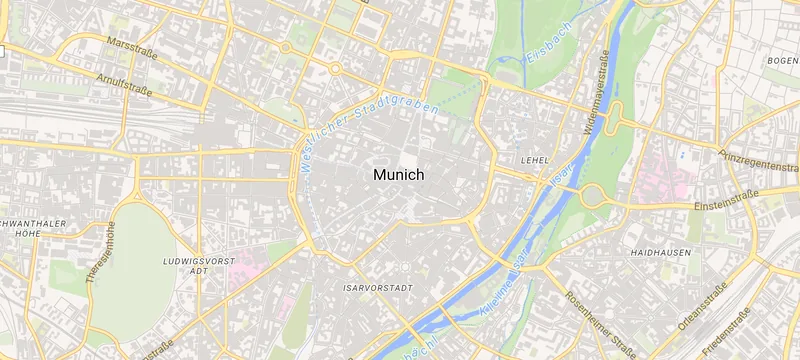](results/shots/2026-10-11-android/munich-z14-fmvt.webp) | [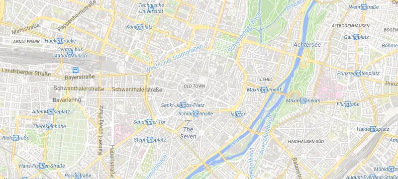](results/shots/2026-10-11-android/munich-z14-vmt-raster.webp) | [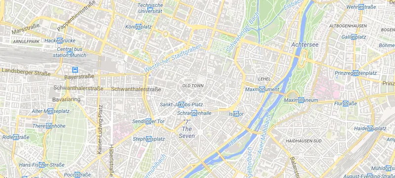](results/shots/2026-10-11-android/munich-z14-vmt-vector.webp) | [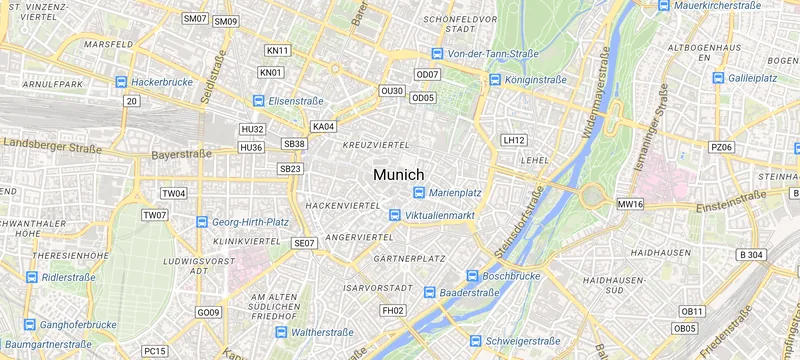](results/shots/2026-10-11-android/munich-z14-fmvt-none.webp) |
| `munich-z16` | [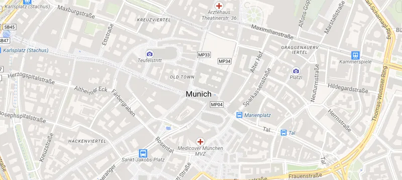](results/shots/2026-10-11-android/munich-z16-fmvt.webp) | [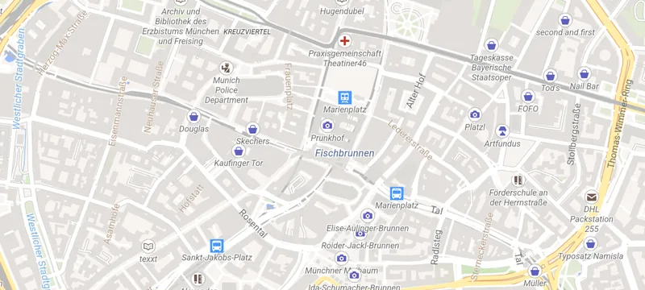](results/shots/2026-10-11-android/munich-z16-vmt-raster.webp) | [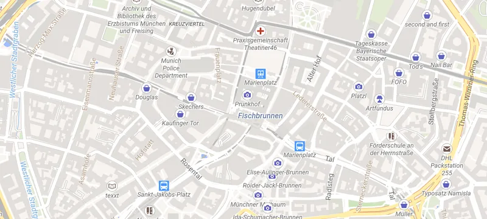](results/shots/2026-10-11-android/munich-z16-vmt-vector.webp) | [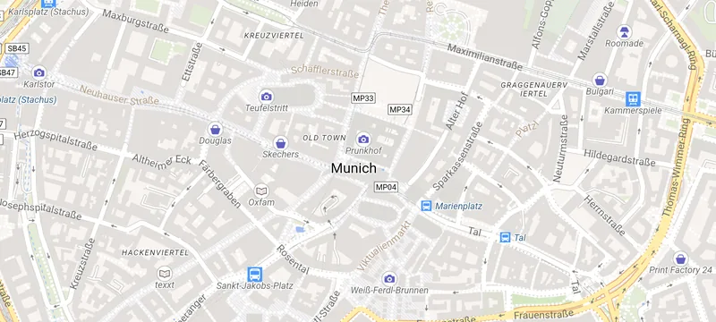](results/shots/2026-10-11-android/munich-z16-fmvt-none.webp) |
| `munich-z16-rot45` | [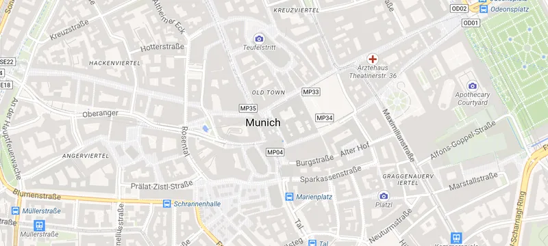](results/shots/2026-10-11-android/munich-z16-rot45-fmvt.webp) | [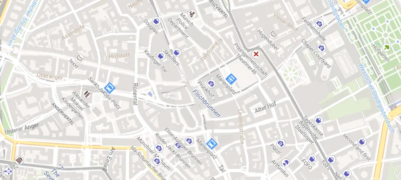](results/shots/2026-10-11-android/munich-z16-rot45-vmt-raster.webp) | [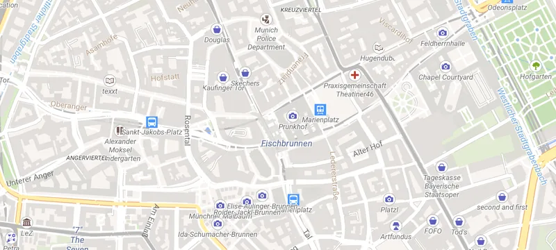](results/shots/2026-10-11-android/munich-z16-rot45-vmt-vector.webp) | [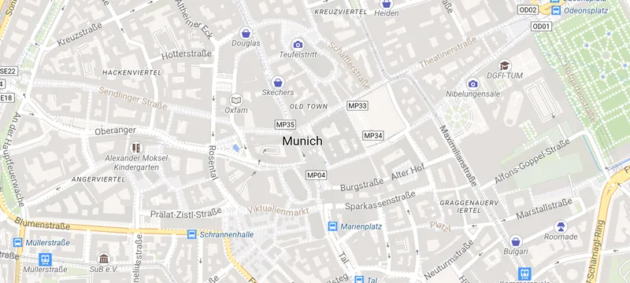](results/shots/2026-10-11-android/munich-z16-rot45-fmvt-none.webp) |
| `munich-z17.5` | [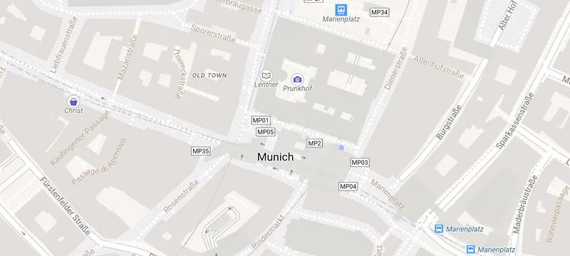](results/shots/2026-10-11-android/munich-z17.5-fmvt.webp) | [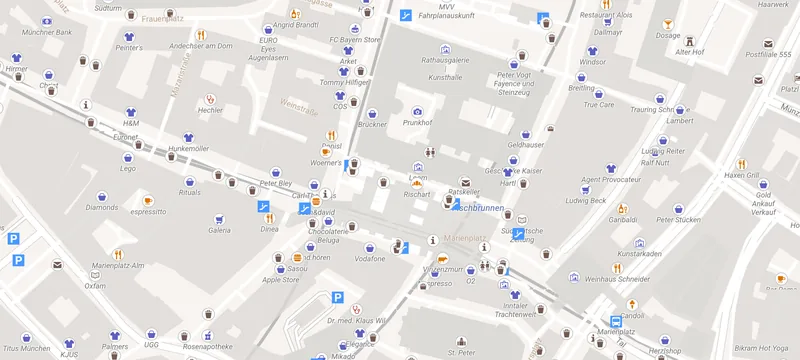](results/shots/2026-10-11-android/munich-z17.5-vmt-raster.webp) | [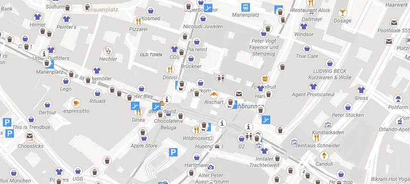](results/shots/2026-10-11-android/munich-z17.5-vmt-vector.webp) | [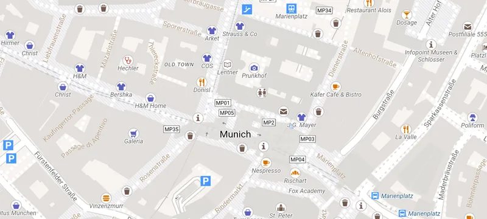](results/shots/2026-10-11-android/munich-z17.5-fmvt-none.webp) |
| `munich-z18` | [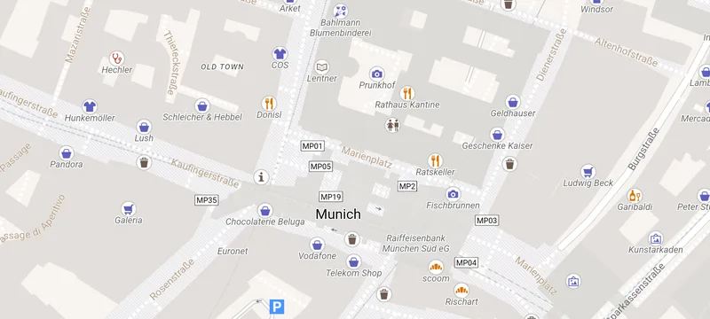](results/shots/2026-10-11-android/munich-z18-fmvt.webp) | [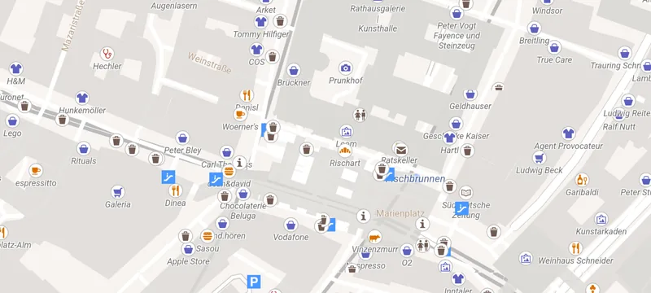](results/shots/2026-10-11-android/munich-z18-vmt-raster.webp) | [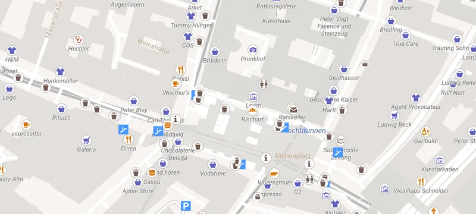](results/shots/2026-10-11-android/munich-z18-vmt-vector.webp) | [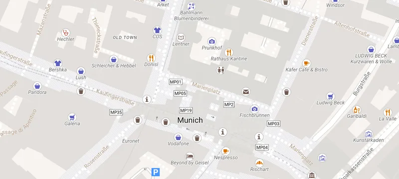](results/shots/2026-10-11-android/munich-z18-fmvt-none.webp) |

Raw data: [results/raw/2026-10-11-android/results.jsonl](results/raw/2026-10-11-android/results.jsonl). An earlier, incomplete session (2026-10-09, 9 of 12 runs, portrait) is kept alongside it.
