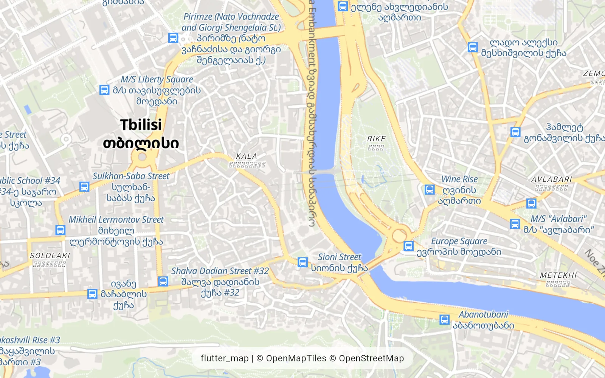
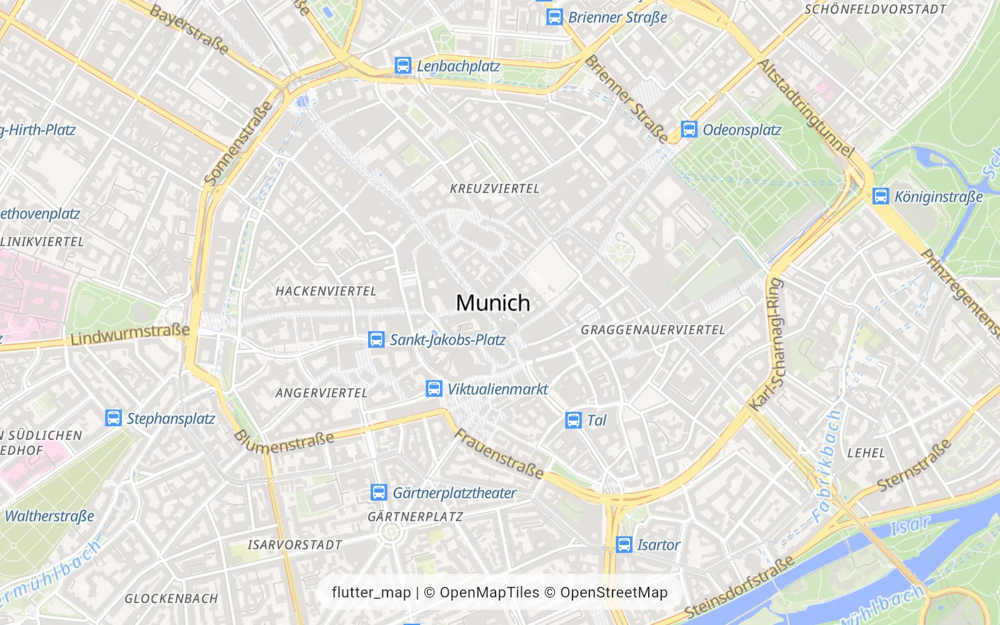
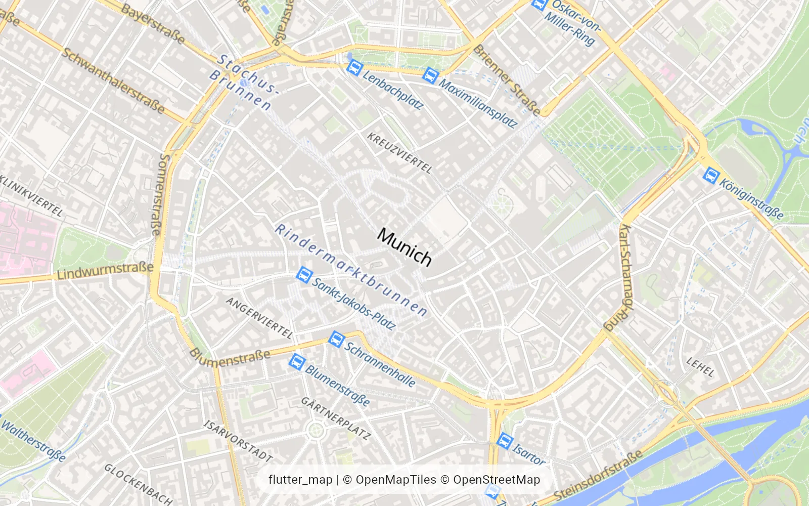

# Labels

How text and icons are placed, which fonts draw them, the two label modes and label language. Part of the [flutter_map_vector_tiles](../README.md) documentation.

- [How labels are placed](#how-labels-are-placed)
- [Fonts](#fonts)
- [Choosing a label mode](#choosing-a-label-mode)
- [Label language](#label-language)

## How labels are placed

By default text and icons are drawn per frame in screen space rather than
baked into the tile rasters, which is what the behaviour below rests on.
`LabelMode.tile` bakes them in instead; [Choosing a label
mode](#choosing-a-label-mode) has what changes then.

### Curved along the road

Glyphs are placed one by one with MapLibre
semantics: `text-max-angle` rejects sharp bends, `text-keep-upright`
flips reading direction, `text-rotation-alignment: viewport` keeps
shield text horizontal. Nearly straight windows are drawn as a single
rotated string for speed; scripts with contextual shaping (Arabic,
Indic, …) fall back to straight placement so glyphs are never
mis-joined. One deliberate difference: a kept-upright label whose road
turns back on itself (a hairpin) is dropped rather than drawn with
the letters past the turn upside down, which `text-max-angle` alone
lets through because each step of a smooth turn stays under it.

### Only where it fits

Anything placed along a line, curved text, a
road shield, a one-way arrow, needs all of itself on the line,
centred on its anchor, as in MapLibre: a ramp or a crossing shorter
than its shield carries none. An icon alone at `line-center` is
exempt, as in MapLibre. The fit is a placement decision, so it is
judged when collision is (see *Collision is decided on a timer*
below), not on every frame.

### Overlap as in MapLibre

A symbol allowed to overlap
(`*-allow-overlap`, `*-overlap: always`) may be drawn over others but
still reserves its own space, so a later label that may not overlap
keeps clear of it; only `*-ignore-placement` gives the space away. A
symbol's text and icon are tested separately, each with its own
overlap setting, and `text-optional` / `icon-optional` decide whether
one may show without the other.

### Words stay whole

`text-max-width` wraps between words; a single
word wider than it gets a line of its own, as in MapLibre, rather
than breaking where the width runs out, and the lines around it
still break at `text-max-width`. Chinese and Japanese wrap between
any two characters, as in MapLibre; Thai, Lao, Khmer, Myanmar and
Tibetan, written without spaces, stay on one line, as they do there.
One difference: Korean may also break between two syllables of a
word, where MapLibre breaks it only at spaces.
Labels drawn in the style's fonts (see [Fonts](#fonts)) are also
balanced as MapLibre balances them.

### Each line reads in its own direction

Every line of the text
field takes its direction from its first letter, as in MapLibre, and
the lines `text-max-width` wraps it into keep that direction: an
Arabic or Hebrew name reads from the right with any Latin word or
number in it on the correct side, a Latin name holding a Hebrew word
reads from the left, and Liberty's Latin name over the local one
gets each line right.

### Repeated road names stay spaced

A street arrives as many features
(one per OSM way, sometimes one per road-class style layer), each spaced
on its own. For `symbol-placement: line`, a visible label therefore
suppresses another copy of the same text from the same source layer
within half of `symbol-spacing` *along the same road* — the two
carriageways of a motorway, neighbouring switchbacks and parallel
same-named roads sit beside each other and keep their labels, as in
MapLibre. The candidate placed first that fits wins (see the next
point); `point` and `line-center` labels are not affected.

### Collisions go the way they go in MapLibre

Of two labels that
collide, the one from the higher style layer wins, then the one with
the lower `symbol-sort-key`. Past that, labels are placed in
MapLibre's order: tile by tile in a fixed order, and within a tile
feature by feature as the tile lists them. So the same label shows
as in MapLibre, and panning or rotating never swaps the winner. One
deliberate difference: a label already on screen keeps its spot
against a newcomer from its own layer, where MapLibre decides every
pair afresh at each placement and lets a label drop out and return
while zooming.

### Zoom ranges, with a ramp at the top

Nothing claims label space
outside a symbol layer's `[minzoom, maxzoom)`, but labels ramp out over
the last quarter zoom level before a declared `maxzoom` instead of
snapping away, and ramp back in on the way out. `minzoom` gets no ramp:
it is inclusive, so one would leave a `minzoom: 14` layer invisible at
exactly zoom 14.

### One fade state per label identity

Beyond that ramp, every
appearance and disappearance is animated per label (the same text or
icon on the same layer, at the same place, across tiles and zoom
levels), rising while the label is placed and falling once it is not,
whatever the reason: a feature the tileset drops at the next zoom, a
label crowded out by denser labelling, a whole layer cut at its
`minzoom`. Each eases out over `labelFadeDuration` instead of vanishing
in one frame. A departing label frees its space immediately, so its
replacement fades in over it: a crossfade, not a pop at the fade's end.

### A placed label always paints

A label that has won its spot is never
held invisible waiting on anything; it fades in from the frame it
arrives. A zoom crossing delivers a screen's labels over tens of frames,
since tiles finish one at a time, and each starts its fade as it lands
rather than at some shared moment.

### No blink when a zoom level hands over

A label that survives the
change keeps its opacity, because the two levels' copies are one label
with one fade state; a crossing can neither blink a label nor fade it
into itself, and only one of the copies draws, as only one copy of a
label on a tile seam does. The outgoing level also only ever *keeps*
labels on screen and never introduces ones that weren't already
visible, so a label that had been crowded out, a street name under a
POI say, cannot flash up just as the level departs.

### Street names stay put across zoom levels

Along-line labels are
spaced out from the middle of their line, so the next level deeper
keeps every position of the current one and only adds names in
between: over the same data (every level past the source's maxzoom) a
street name you are looking at doesn't move when a level hands over.
Where the next level brings its own data tiles, the clipped lines
differ, or where the style's `symbol-spacing` changes with the zoom, a
name can genuinely sit elsewhere on its road; the name at its new
position is then a label of its own, fading in while the old position
eases out, instead of the name teleporting at full opacity.

### Placement is remembered, not re-derived

A label drawable from more
than one feature, a street name on both carriageways or the same name
from two zoom levels, stays on the one it is already on; a label at a
`text-variable-anchor` stays at the anchor it took; a road label near
vertical keeps reading the way it was reading. A slow pan therefore
doesn't walk a street name across its street. Those choices are
remembered per label, matched across tiles by its text and position,
rather than per tile, so they survive a level handing over or a tile
re-rendering underneath a label that never left the screen.

### Collision is decided on a timer

Camera motion and changed label
candidates are picked up at the next `labelFadeDuration` interval, at
most 300 ms away, and the previous decision is held in between. Zooming
and rotating drag labels through each other constantly, and re-deciding
every frame turns each of those brushes past into a label that disappears
and comes straight back. Between decisions neighbours are simply allowed
to overlap for a moment, as they are in MapLibre. A label along a line
accepted by a decision, a curved street name or a road shield, also
keeps drawing until the next one, even if zooming makes its road bend
too sharply under it or the label outgrow its stretch of road; it then
fades out instead of vanishing. An unchanged
repaint creates no new placement work, so the animation ticker settles
when the last real change has been placed. Except on web (and for
styles whose label expressions use `within` or `distance`, or read
`feature-state` while a controller is attached), the
decision itself is taken on a separate isolate, from the text the map
has already shaped, and shown from the frame after it was asked for.

## Fonts



Pass `glyphs: style.glyphs` and labels are drawn in the style's own
fonts, from the glyph PBFs its `glyphs` URL serves, as MapLibre draws
them: Noto Sans for OpenFreeMap, whatever your MapTiler or self-hosted
style was designed with. Without it every label uses the system font.

- **Which labels.** Latin (with its accents and the letters of every
  European language), Greek, Cyrillic, Armenian and Georgian, digits
  and punctuation. A label with anything else keeps the system font
  and the platform's text shaper, which handles what glyph PBFs can't:
  right-to-left scripts, Indic and Southeast Asian scripts, combining
  marks, emoji. So do CJK labels — MapLibre also draws those from a
  local font by default, since their glyph ranges are large — and
  labels whose glyphs the font lacks.
- **Laid out like MapLibre.** Advances, `text-letter-spacing`,
  `text-max-width` wrapping into balanced lines (a two-line name gets
  two similar lines, not a full line and a dangling word),
  `text-line-height` and `text-justify`, halos at MapLibre's
  distance-field threshold, and `text-halo-blur` as a wider edge on
  that threshold, as MapLibre blurs them.
- **Cheaper to lay out.** The text is laid out in Dart from the glyph
  metrics, not by the platform's text shaper, which on a dense tile
  was the largest single cost on the UI thread: 31–32 ms for one dense
  Munich tile on a Nothing Phone (1), against 0.7–0.8 ms now.
- **Loading.** Ranges of 256 characters are fetched on first use, about
  75–135 KB each for the Latin ones; `StyleReader` asks for the first
  range of every font while the style loads. A tile's labels wait for
  the ranges they need rather than appearing in the system font and
  switching — for up to 5 s, after which a slow connection gets them
  in the system font until the range arrives. Ranges go through the
  style cache, so they are there offline wherever the map has been; a
  range that cannot be loaded leaves its labels in the system font.
- **Your own glyphs.** `GlyphSource(load: …)` reads ranges from
  anywhere, assets included, for a fully offline map with the style's
  fonts.

## Choosing a label mode

<table>
  <tr>
    <td width="50%" align="center" valign="top">
      <br>
      <code>LabelMode.screen</code> (default)
    </td>
    <td width="50%" align="center" valign="top">
      <br>
      <code>LabelMode.tile</code>
    </td>
  </tr>
</table>

The same map turned by 30°: labels drawn in screen space stay upright, labels baked into the tiles turn with them.

The screen-space pass is what makes labels behave as above, and it is
also the one part of a moving map that costs UI-thread time on every
frame: every placed label laid out and drawn again. The collision pass
over every candidate, every `labelFadeDuration` (300 ms at most), runs on
an isolate of its own — except on web, where it runs in the frame. On a
label-dense screen and a mid-range phone that cost decides whether
panning, rotating and pinching hold the display's frame rate.

`labelMode: LabelMode.tile` removes it. Labels and icons are placed and
drawn once per tile, when the tile is rendered, into the same image as
its roads and buildings, so a moving map draws nothing but tile images,
as `vector_map_tiles` does in its default raster mode. The same text
engine draws them (curved road names, halos, SDF icons and all), but
they inherit the limits of any pre-rendered tile:

| | `LabelMode.screen` (default) | `LabelMode.tile` |
|---|---|---|
| Per-frame label work | placed labels laid out and drawn every frame, a collision pass every `labelFadeDuration` (at most 300 ms) on a separate isolate (in-frame on web) | none |
| Collision | one pass across the whole screen | within each tile |
| At tile seams | seamless | a label that would cross a tile edge is dropped, so labels thin out along tile seams; a road name repeated along a road is thinned out only within a tile, so it can show on both sides of a seam |
| Under rotation | text stays upright | text rotates with the map |
| Between zoom levels | sized for the exact zoom | sized for the tile's zoom level, then scales with the map (up to twice the size) until the next level's tiles replace it |
| `minzoom`/`maxzoom` | cut and ramped at the exact zoom | applied at the tile's zoom level: `minzoom: 12.2` shows from 13, `maxzoom: 16.5` until 17 |
| Fades | per label, `labelFadeDuration` | with the tile, `tileFadeDuration` |
| New tiles | geometry first: every queued tile's geometry before any tile's labels, with the previous level's labels covering the gap | each tile appears complete, labels included; the previous level covers it until then |

Texture memory is the same in both modes: the labels are drawn into the
tile's existing image, so `rasterCacheMaxBytes` needs no adjustment.

Measured with [`compare/`](../compare) on a Nothing Phone (1) at 60 Hz,
same style and tiles, three runs each: with `LabelMode.tile` the map
got a frame on 94–98% of display refreshes while zooming, panning,
rotating and flinging, against 78–86% in the default mode, and the UI
thread's 90th percentile fell from 15.4–21.7 ms to 3.6–9.3 ms. The first
complete map took 0.95 s, against 1.05 s in the default mode. On an
iPhone 15 Pro Max both modes get 99–100%, on a MacBook Pro (M4 Pro)
they are within a point of each other at 97–100%, and in Chrome the
default gets 91–100%, so the choice matters most on a mid-range
phone.

## Label language

`StyleReader(language: 'de')` shows labels in German wherever the tiles
carry a German name, and in the style's own label text everywhere else:

```dart
final style = await vt.StyleReader(
  uri: 'https://tiles.openfreemap.org/styles/liberty',
  language: 'de',
).read();
```

Each label looks for `name:de` first, the tag OpenMapTiles-schema tiles
(MapTiler, OpenFreeMap) use, then for `name_de`, the one Mapbox Streets
and Shortbread tiles use. A feature with neither keeps exactly the text
the style gives it. So how much of the map changes language depends on
the tiles, not on the style: OpenStreetMap-based tiles have translations
for countries, cities and well-known places, and mostly none for
streets.

Only the name changes. Whatever the style shows beside it, a peak's
elevation or a road's ref, stays, and a style that shows a place in two
scripts (Liberty's `name:latin` over `name:nonlatin`) shows the
translation once. The style's `resolved-locale` expression returns the
language as well; without one it returns `en`.

The language is fixed per `Style`. To switch, read the style again with
the other language: the cached style document serves both, and each
language keeps its own finished tiles.

