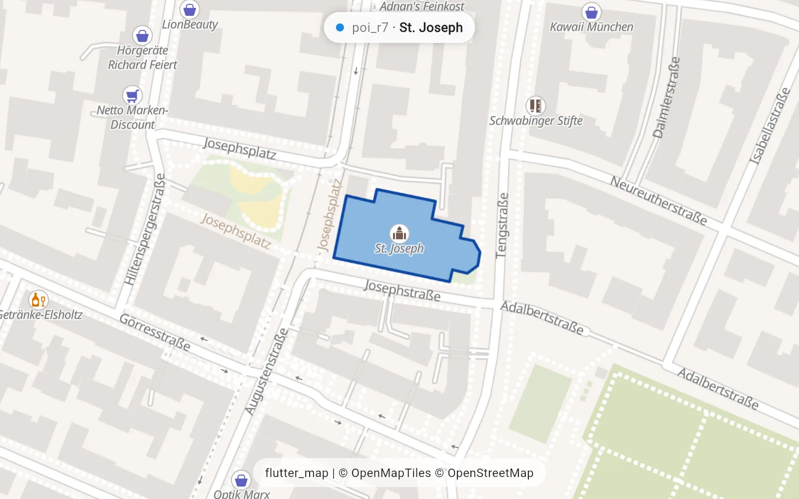

# Querying features and feature state

Ask what is drawn at a point, and restyle single features at runtime. Part of the [flutter_map_vector_tiles](../README.md) documentation.



- [Example](#example)
- [Queries](#queries)
- [Feature state](#feature-state)

## Example

A `VectorTileLayerController` answers what the layer draws at a point
or in a rectangle (MapLibre's `queryRenderedFeatures`) and holds feature
state that the style reads back through `["feature-state", key]`
(MapLibre's `setFeatureState`). Tap to highlight a building:

```dart
final features = vt.VectorTileLayerController();

FlutterMap(
  options: MapOptions(
    onTap: (tap, _) {
      final hit = features
          .queryRenderedFeatures(tap.relative!)
          .where((f) => f.sourceLayer == 'building' && f.id != null)
          .firstOrNull;
      if (hit == null) return;
      features.setFeatureState(
        source: hit.source,
        sourceLayer: hit.sourceLayer,
        id: hit.id!,
        state: {'selected': true},
      );
    },
  ),
  children: [
    vt.VectorTileLayer(
      controller: features,
      theme: style.theme,
      tileProviders: style.providers,
    ),
  ],
)
```

## Queries

Take a point or a `Rect` in the map widget's logical pixels
(`TapPosition.relative`), optionally limited to some style layer ids,
and return `RenderedFeature`s topmost first: the labels and icons the
last frame drew, then fill, line and circle features, from the topmost
style layer down. Each carries the **style layer id** that drew it,
`source`, `sourceLayer`, `id`, `properties`, `geometryType` and its
current `state`. A feature is hit where it is drawn: inside a polygon
(holes excluded), within half a line's width (casing included) of a
line, within a circle's radius plus stroke, on a label's text or icon
box, with the map rotated or not. Paint opacity does not matter, as in
MapLibre, so a transparent layer can serve as a wider tap target. A
feature with an id is returned once per layer however many tiles it
spans; one without an id may come back once per data tile. A query is
synchronous and reads only what is already in memory. On a Nothing
Phone (1), on a dense z16 Liberty screen of Munich, a tap takes 1.1 ms
(median) and a 48 px square 2.0 ms, 6.7 ms at worst in 99 of 100.

Query results carry the properties the decoded tiles kept, which are
only those the style reads. `retainAllProperties: true` keeps every
property instead, at a cost that depends on the tiles: on OpenMapTiles
data, which carries a name in dozens of languages for every place,
the nine z14 tiles around central Munich decode to 20.6 MiB instead of
16.3 MiB (+27%). Decoded tiles stay within `memoryCacheMaxBytes` either
way, so the cost shows as fewer tiles held in memory (about a fifth
fewer there), not as unbounded growth.

## Feature state

Is per feature, keyed by source, source layer and id,
and merged like MapLibre's: `setFeatureState` adds keys,
`removeFeatureState` takes one key, one feature or a whole source layer,
and `getFeatureState` reads it back. A number id and its decimal string
name the same feature. The state lives in the controller, so it outlives
a rebuilt or remounted layer; a controller drives the layer that mounted
last. It changes what is drawn only where a
paint property reads it, such as
`"fill-color": ["case", ["boolean", ["feature-state", "selected"],
false], "#e53935", "#d6d0c4"]`; hosted styles don't, so add a layer of
your own (the example app appends one over the style's buildings).
A change re-renders only the display tiles that draw the feature from a
layer that reads state, ahead of other queued work and without a fade;
labels keep their placement, and screen-space labels whose paint reads
state follow on the next frame — one the state shows or hides through
its opacity is placed or dropped by the next collision pass, within one
`labelFadeDuration`. Labels whose opacity reads state place on the UI
thread rather than the placement isolate while a controller is
attached, since the isolate sees no state. On the same phone and screen, selecting
a building redraws the display tiles that draw it (all 8 on screen
there, since the merged features described below span them) in about a
quarter of a second: 215–250 ms median over 7–8 frames, most of them
over a 60 Hz budget, as any tile load is. Clearing it again is served
from the finished-tile cache. Feature ids come from the
tiles, or from the property a source's `promoteId` names.

A feature is whatever the tiles encode as one, and some tiles merge.
OpenFreeMap's, for one, join neighbouring buildings with the same
attributes into a single multipolygon with a single id (up to 1,563
buildings in one feature in central Munich at z14), so a query returns
that whole group and selecting it highlights all of it, as MapLibre
would.

