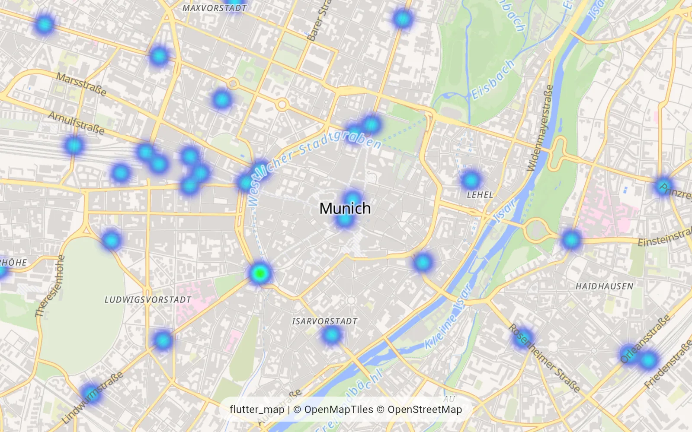
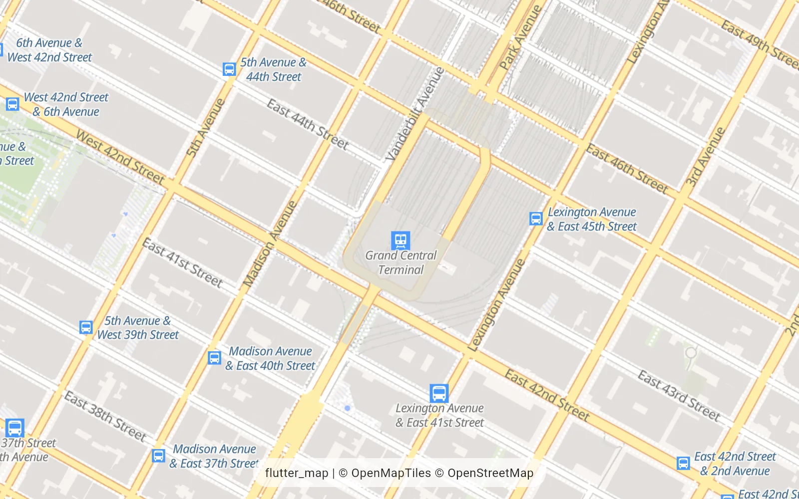
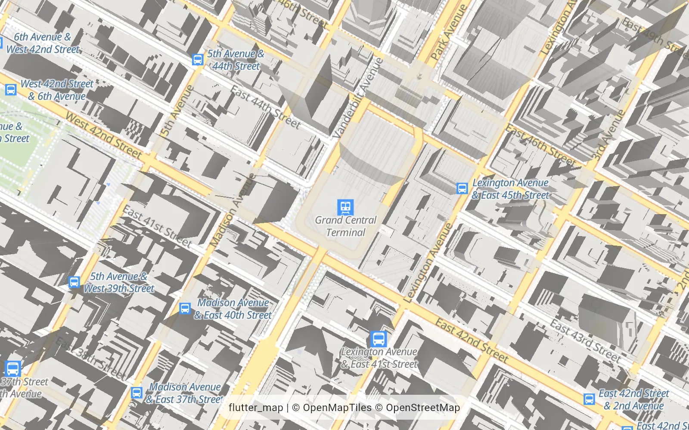

# Style support

Which parts of the MapLibre style spec are drawn, and where the result differs from MapLibre GL. Labels have their own page: [Labels](LABELS.md). Part of the [flutter_map_vector_tiles](../README.md) documentation.

- [Layer types](#layer-types)
- [Geometry properties not drawn](#geometry-properties-not-drawn)
- [Icons](#icons)
- [Symbol properties](#symbol-properties)
- [Heatmaps](#heatmaps)
- [3D buildings](#3d-buildings)
- [Expressions](#expressions)
- [Global state](#global-state)

## Layer types

| Type | Support |
|---|---|
| `background`, `fill`, `line`, `circle` | full, including `fill-pattern`, `line-pattern`, `background-pattern`, dashes and casing, `line-offset`, `line-blur`, `line-miter-limit`, `circle-blur`, the `*-translate` and `*-sort-key` properties; see the notes below the table |
| `symbol` | every layout and paint property but `text-writing-mode` and the pitch alignments (flutter_map has no pitch), including curved line text, variable anchors and `icon-text-fit`; see *Symbol properties* and [Labels](LABELS.md) below |
| `hillshade` | terrain shading computed from a `raster-dem` source (`terrarium`, `mapbox` or `custom` encoding), drawn at its layer position with every paint property: all five `hillshade-method`s (`standard`, `basic`, `combined`, `igor`, `multidirectional`, up to four lights), illumination direction, altitude and anchor, exaggeration, shadow/highlight/accent colours and `resampling`. Slopes are read across tile edges from the neighbouring elevation tiles, so the shading has no seams. One difference: tiles are shaded once and turn with the map, so `hillshade-illumination-anchor: viewport` (the default) is drawn as if the map were not rotated; with `map` it matches MapLibre at every bearing |
| `raster` | raster sources *inside* vector styles (satellite/hybrid imagery) draw at their layer position, with `raster-opacity`, brightness/contrast/saturation/hue-rotate matching MapLibre's shader math, and `resampling` / `raster-resampling` |
| `fill-extrusion` | flat footprints in `fill-extrusion-color` and `-opacity` by default; with `extrusionMode: ExtrusionMode.perspective`, 3D buildings, as MapLibre draws them with the camera looking straight down: `fill-extrusion-height`, `-base`, `-color`, `-opacity` (applied to the whole layer, as MapLibre does), `-vertical-gradient` and `-translate`, shaded by the style's root `light`; see **3D buildings** below. Patterned ones (`fill-extrusion-pattern`), and all of them with `LabelMode.tile`, draw as flat footprints in either mode. The alpha of `fill-extrusion-color` darkens the colour rather than making it translucent, as in MapLibre |
| `heatmap` | the kernel density MapLibre draws over a source layer's points, with `heatmap-radius`, `-weight`, `-intensity`, `-opacity` and a `heatmap-color` ramp over `["heatmap-density"]`, data-driven weight and radius included; drawn over all the tile geometry, see **Heatmaps** below |
| `color-relief`, `sky` | skipped, with a log line |

## Geometry properties not drawn

`line-gradient` needs a GeoJSON
source with `lineMetrics`, which this package does not read (MapLibre
refuses the style when it sits on a vector source); the line keeps its
`line-color`. `line-round-limit` is ignored: round joins stay round at
every angle, a difference below a pixel at the default limit. A
`*-translate-anchor` of `viewport` is drawn as `map`, which differs
only while the map is rotated, because a tile is drawn once and rotated
with the map. Where `line-offset` meets a sharp turn the shifted line
is beveled on the outside, where MapLibre leaves a gap and its two
segments cross. A `line-blur` under about 0.6 px on a 3× screen (0.9 px on
a 2× one) only narrows the line by what the blur takes, without
softening its edges: a blur costs GPU passes, and blurring every road of
a style by 0.5 px cost a phone a sixth to two thirds of its frames while
tiles were drawn. A blurred casing (`line-gap-width`) softens only its
outer edge, and a blurred dashed line running exactly along a tile axis
is drawn sharp: Impeller, Flutter's renderer on iOS and Android, draws
those two wrongly when blurred.

## Icons

SDF sprite sheets (`"sdf": true`) are thresholded and tinted
per `icon-color`, `icon-halo-color`, `icon-halo-width` and
`icon-halo-blur`; dark MapLibre styles ship their icons this way.
Ordinary sprites are drawn with the colours baked into the sheet. `StyleReader` repacks the sheet with a
transparent gutter around every icon, as MapLibre does, so a scaled icon
never picks up the edge of its neighbour in the sheet. `icon-rotate` and
`icon-rotation-alignment` follow MapLibre's viewport/map/line semantics,
including camera bearing, icon anchor/offset rotation and rotated collision
bounds.

## Symbol properties

Beyond text, icons and their anchors, offsets,
sizes and colours, the label pass reads:

- `text-halo-blur`, a soft halo edge as MapLibre draws it;
- `icon-text-fit` and `icon-text-fit-padding`, honouring a sprite's
  `stretchX`, `stretchY` and `content`, so a road shield stretches
  where its designer said it may and frames its text;
- `text-variable-anchor-offset`, and `text-offset` with
  `text-variable-anchor` (taken as distances away from each anchor, as
  in MapLibre);
- `text-justify` (with `auto`) and `text-line-height` for multi-line
  labels;
- `text-optional` and `icon-optional`, `icon-padding`, `text-overlap` /
  `icon-overlap` (`never`, `always`, `cooperative`), the older
  `*-allow-overlap`, and `*-ignore-placement`;
- `symbol-sort-key`, `symbol-z-order` and `symbol-avoid-edges`;
- `text-rotate`, `text-rotation-alignment: map` for point labels,
  `icon-keep-upright`, and `text-translate` / `icon-translate` with their
  anchors.

`text-writing-mode` is not supported: CJK text is laid out
horizontally, and the reader logs the property. `symbol-avoid-edges`
keeps a symbol inside the 256 px display tile it was laid out in, which
past a source's maxzoom is smaller than the data tile MapLibre bounds it
by, so more labels near seams give way. `text-rotate` turns
point labels only, and text with an icon fitted around it is drawn
straight even along a line. Without the style's glyphs (see
[Fonts](LABELS.md#fonts)), `text-font` picks the weight and style of the
platform's fonts.

## Heatmaps



A heatmap's density spans tiles — a kernel near
a seam reaches into the neighbour — so it is drawn in screen space, like
MapLibre: the points of every visible tile summed into one density at a
quarter of the device resolution, coloured through `heatmap-color` and
drawn as one image over the tiles. The density is recomputed when the
zoom, the tiles or the screen change, at most every 100 ms, on a worker
isolate (on the event loop on web); in between, the last image follows
the camera, so panning and rotating are exact while a pinch scales the
kernels with the map until the next pass catches up. Where it differs
from MapLibre:

- a heatmap layer draws above every `fill`, `line`, `circle`, `raster`,
  `hillshade` and `fill-extrusion` layer, wherever the style puts it, and
  below the
  labels and icons. Most styles put their heatmap there anyway; one
  sitting under roads or buildings covers them here. With
  `LabelMode.tile` the labels are part of the tile images, so the
  heatmap covers them too;
- only point features count. MapLibre also takes every vertex of a line
  or polygon as a point.

## 3D buildings

<table>
  <tr>
    <td width="50%" align="center" valign="top">
      <br>
      <code>ExtrusionMode.flat</code> (default)
    </td>
    <td width="50%" align="center" valign="top">
      <br>
      <code>ExtrusionMode.perspective</code>
    </td>
  </tr>
</table>

Off by default: `fill-extrusion` layers draw as
flat footprints, as in every release before, so updating the package
changes no map. `extrusionMode: ExtrusionMode.perspective` turns them
on. flutter_map's camera has no pitch, so the map never tilts; what MapLibre shows of a building with the camera looking
straight down is drawn instead. Its camera is a perspective one, 1.5
viewport heights above the map, so a roof `h` metres up is drawn
scaled away from the screen centre by `D / (D − h · pixels per
metre)`: buildings lean outward, more the further they are from the
centre, the taller they are and the closer the zoom, and the walls
facing the centre show — a 50 m building 300 px from the centre of an
800 px tall map leans 16.6 px at style zoom 16. Because that changes
with every pan and zoom, the buildings are not in the tile images: each
frame projects the ones on screen and draws them over the tiles, the
lowest roof first, each building's walls before its roof; one of
height 0 is a roof on the ground, as in MapLibre. Roofs and
walls are shaded as MapLibre's shader does, by the style's root
`light` (MapLibre's default when the style has none) and
`fill-extrusion-vertical-gradient`. Rendered-feature queries find a
building where it is drawn, its roof and its walls. Next to MapLibre GL
JS over central Munich at style zoom 15–17, the screenshots differ by
3–6 per colour channel on average, from 13–17 with flat buildings, and
78–90 % of the wall pixels coincide
([compare/RESULTS.md](../compare/RESULTS.md#3d-buildings)). Where it
differs from MapLibre:

- what the style puts above its first extrusion layer draws over the
  buildings, roofs included, as in MapLibre: Liberty's boundary lines,
  or a route or highlight an app adds on top. The difference is in
  between: the buildings of all extrusion layers are drawn together,
  so a layer between two of them draws over both, and a heatmap draws
  over the buildings wherever the style puts it;
- painter's order stands in for MapLibre's depth buffer: where a lower
  roof leans over a detached taller building through a gap narrower
  than the lean, or one part of a concave building over another, the
  overlap can be drawn the wrong way round. A wall with another
  building right in front of it — a terraced neighbour, the outline a
  taller building part rises out of — starts at that building's roof,
  as the depth buffer would show it;
- a wall leaning less than half a pixel is left out, and walls leaning
  under 3 px share their corners, so their colour runs into the next
  wall's instead of changing at the corner;
- a height reading both the zoom and the feature is blended linearly
  between whole zoom levels.

The per-frame cost is UI-thread time in proportion to the buildings on
screen: most at style zoom 14, where a phone screen shows the most of
them. On a Nothing Phone (1), Liberty over central Munich, zoom sweeps
against the flat drawing of the release before: at style zoom 14 the
pass takes 2.4–4.0 ms a frame (median, 33k vertices) and puts 0.5–1.2
ms on the 90th-percentile UI frame; at 16 it takes 0.9 ms and at 18
0.3 ms, and the frames get no slower, as the tiles no longer draw the
buildings. With labels off the phone runs the UI thread at lower
clocks, and the same pass at zoom 14 takes 8.8 ms: fast sweeps there
fell from 59.5 to 43.6 frames a second. On an iPhone 15 Pro Max
frames delivered stayed at 99–100 %. Over the comparison's scripted
zooms, pans, rotations and flings
([compare/RESULTS.md](../compare/RESULTS.md)), the Nothing Phone got
84–92 % of frames with 3D buildings against 91–96 % without, 3 to 9
points less, most while panning and flinging; the iPhone and the Mac
stayed within 1 point, and Chrome within 2.3 except on the first fling
(5.8 points). The buildings' meshes are cut
while a tile is decoded, only for tiles at zooms where a 3D layer
draws, and kept with it — 65–550 KB a tile in
central Munich, counted against `memoryCacheMaxBytes`, so the same
budget holds fewer decoded tiles, and, for as long as a finished tile
in the raster cache holds them, against `rasterCacheMaxBytes` too; on the iPhone the app's memory at
the first screen rose by about 20 MB. The default,
`ExtrusionMode.flat`, draws them flat in the tile images instead, at
no per-frame cost and without the meshes.

## Expressions

Every operator of the current MapLibre style spec
compiles, as do legacy filters, legacy `{stops}` functions (zoom,
property and zoom-and-property ones, with `{token}` templates in their
`text-field` / `icon-image` outputs) and `{token}` templates. The engine
is checked against all 583 expression fixtures of `maplibre-style-spec`:
the 425 that MapLibre evaluates give MapLibre's results, apart from 42
listed one by one, with the reason, in
`test/maplibre_expression_conformance_test.dart`.

Evaluation is as strict about types as MapLibre's. Where an operand has
the wrong type — a numeric string compared with a number or fed to
`+`, a `case` condition that is not a boolean, an array index out of
bounds, an `rgb` channel above 255 — the property falls back to its
default and a filter leaves the feature out, as in MapLibre. Number,
boolean and array properties take only values of their type, so
`["get", "size"]` with `"12"` in the tile is not a text size of 12;
`["to-number", ["get", "size"]]` is. Math follows JavaScript's:
`["/", 1, 0]` is Infinity, which a property then falls back on. Legacy
functions follow the same rules: a property function needs a number,
not a numeric string, and an identity function falls back to its
`default` for a value of the wrong type — though `text-field`,
`icon-image` and the patterns take any value, a number as its digits,
as MapLibre's do. A few operators answer with a fixed value because what
they read does not exist here:

| Operator | Here |
|---|---|
| `within`, `distance` | the feature's geometry against the GeoJSON given; `distance` in metres, as MapLibre measures it |
| `global-state` | see [Global state](#global-state) below |
| `number-format` | digits, separators and currency per locale (through `intl`); `unit` symbols are the English short ones (`m`, `km/h`, `°C`) in every locale |
| `feature-state` | the state set through a `VectorTileLayerController` (see [feature state](QUERYING.md)); null for a feature that has none |
| `elevation` | always null: no `raster-dem` source or `color-relief` layer is drawn |
| `heatmap-density` | the kernel density, in a heatmap layer's `heatmap-color`; 0 anywhere else |
| `line-progress`, `accumulated` | always 0 |
| `collator` | ignored: strings compare by code unit, whatever the locale, case or diacritic options |
| `is-supported-script` | always true: every script is shaped by the platform |
| `image` | the image name, whether or not the sprite sheet has it |
| `format` | the text only: style overrides and inline images are left out |

Sources' `promoteId` is applied, so `["id"]` and feature state see the
promoted property.

Unsupported layer types, paint properties and expressions are skipped per
layer with a warning, so one weird layer never kills the whole style.

## Global state

A style's `global-state` expressions read values the app sets, with
defaults from the style's root `state`. `Theme.withGlobalState` gives
the theme for other values. Keys you leave out, or set to null, keep
their default:

```dart
VectorTileLayer(
  theme: style.theme.withGlobalState({'showTrails': showTrails}),
  tileProviders: style.providers,
)
```

The values are compiled into the theme, so changing them never slows
down drawing: each state is its own theme, and the same state returns
the same instance, which makes the call safe in `build`. When the layer
gets a theme that differs only in its state, it redraws its tiles from
the data it already has, the old imagery staying until the new one is
ready. Nothing is fetched or decoded again. Each change still redraws
every visible tile, so drive it from a toggle or a picker, not from a
slider that changes on every frame. Keys no expression in the style
reads are ignored, so passing more of your app's state than the style
needs returns the same theme and redraws nothing; a key the style reads
without declaring it in `state` still takes effect. `theme.globalState`
holds the values in effect. A style that reads no global state returns
itself.

